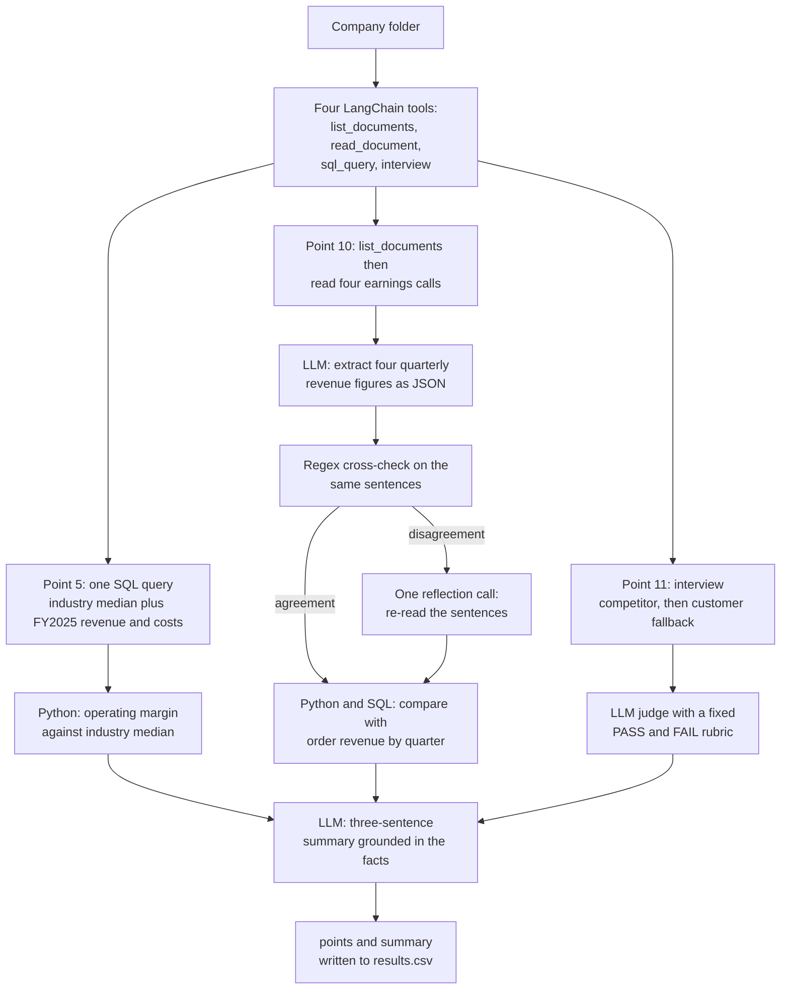

# FTEC5660 Homework 3: Fisher's 15-Point Investment Agent

Build a LangChain agent that researches a company with tools and applies the
framework from Philip Fisher's *Common Stocks and Uncommon Profits* (Part One,
Chapter 3 "What to buy: the fifteen points to look for in a common stock", and
Chapter 4 "What to buy: applying this to your own needs"). You choose 3 of
Fisher's 15 points and decide yourself what PASS means for each. For every
company your agent gives a PASS/FAIL verdict on your 3 points and a short
summary.

The companies are fictional, so the model cannot answer from memory. Unlike a
pile of reports, the evidence is spread over three sources, and your agent has
to go and get it with tools, the way Fisher's "scuttlebutt" method sends an
investor to talk to customers, competitors, suppliers and staff.

## Data and tools

`public_test/` has one folder per company. Your code receives four tools per
company (built by the provided code in `hw3.py`):

| Tool | What it gives you |
| --- | --- |
| `list_documents()` | the company's six documents and their dates |
| `read_document(name)` | one document: the 2025 letter to shareholders, four earnings calls (Q3 2025 to Q2 2026) and a news file (July 2025 to July 2026) |
| `sql_query(query)` | one read-only SQLite query on the company's database; at most 50 rows come back, so use `SUM`, `GROUP BY` and `WHERE` |
| `interview(role, topic)` | what one person says about the company; at most **10 interviews per company** |

The documents are what management says. Management's own claims (such as "we
have never cut research" or "our people are our greatest strength") are not
evidence on their own: check them against the database and the interviews.

**Database tables** (amounts in USD thousands; dates `YYYY-MM-DD`, months
`YYYY-MM`, quarters like `2025Q3`; the fiscal year is the calendar year):

| Table | Columns |
| --- | --- |
| `company` | name, industry |
| `industry_medians` | industry, revenue_growth_2y_pct, new_product_share_pct, new_product_sales_per_rd, operating_margin_pct (one row per industry; use the row for the company's own industry) |
| `orders` | order_id, order_date, product, customer, amount, note (about 3,000 to 4,000 orders from January 2023 to June 2026; revenue is the sum of order amounts) |
| `products` | product, launch_date |
| `monthly_costs` | month, cost_of_sales, selling_admin, research_development |
| `quarterly_cash` | quarter, operating_cash_flow, capex, cash_end |
| `capex_plan` | year, planned_capex (2026 to 2028) |
| `returns` | month, units_shipped, units_returned |
| `insider_trades` | trade_date, person, title, side (`buy` or `sell`), shares, price |

**Terms used in the data.**

| Term | Meaning |
| --- | --- |
| FY2025 | Fiscal year 2025. Here the fiscal year is the calendar year, so FY2025 is January to December 2025. |
| Quarter | Three months of the year: Q1 is January to March, Q2 April to June, Q3 July to September and Q4 October to December. The database writes `2025Q3`; the documents write "third quarter 2025". |
| Amounts | The database is in **USD thousands** (676,100 means US$676.1 million). The documents use USD millions. |
| Revenue | Money from sales: the sum of `amount` in `orders`. |
| Cost of sales | The cost of making the products that were sold. |
| Selling and admin | The cost of selling and of running the company (sales staff, offices, management). |
| R&D | Research and development spending, mainly on new products. |
| Operating margin | Operating profit as a share of revenue: (revenue − cost of sales − selling and admin − R&D) ÷ revenue. |
| Operating cash flow | Cash that the day-to-day business brings in during a quarter. |
| Cash at the end of a quarter | The cash the company holds on the last day of that quarter (`cash_end`). |
| Capex | Capital expenditure: spending on factories, machines and other long-term assets. `capex_plan` holds the planned capex for 2026 to 2028. |
| Return rate | Units returned ÷ units shipped, from the `returns` table. |
| Industry median | The middle value for companies in the same industry, from `industry_medians`. |
| Insider | A director or senior manager of the company. `insider_trades` lists the shares they bought (`buy`) or sold (`sell`). |
| Earnings call | A meeting each quarter where management presents the quarter's results to investors. Each call quotes that quarter's revenue. |

**Interviews.** Roles: `customer`, `current_employee`, `former_employee`,
`competitor`, `supplier`. Topics: `sales_team`, `working_conditions`,
`top_management`, `decision_making`, `competitive_edge`. Only some people know
about each topic; the others say they can't comment, and that answer still
uses up one interview.

| Topic | Who knows about it |
| --- | --- |
| `sales_team` | customer, competitor |
| `working_conditions` | current_employee, former_employee |
| `top_management` | former_employee, supplier |
| `decision_making` | supplier, customer |
| `competitive_edge` | competitor, customer |

People who know about a topic always agree with each other, so one good answer
is enough.

## Choose your 3 points and your rules

Pick any 3 of Fisher's 15 points and write them in `CHOSEN_POINTS` near the
top of `hw3.py`, e.g. `CHOSEN_POINTS = [1, 7, 15]`. The full questions are in
`FISHER_POINTS` in `hw3.py` and in the book.

| # | Fisher's point | Where the evidence is |
| --- | --- | --- |
| 1 | Market potential for sales growth | database |
| 2 | New products as current lines mature | database |
| 3 | Effective research and development | database |
| 4 | Above-average sales organization | interviews (`sales_team`) |
| 5 | Worthwhile profit margin | database |
| 6 | Maintaining or improving margins | database |
| 7 | Labour and personnel relations | interviews (`working_conditions`) |
| 8 | Executive relations | interviews (`top_management`) |
| 9 | Depth of management | interviews (`decision_making`) |
| 10 | Cost analysis and accounting controls | earnings calls, checked against the database |
| 11 | Advantage over competitors | interviews (`competitive_edge`) |
| 12 | Long-range outlook on profits | database |
| 13 | Growth without dilutive equity financing | database |
| 14 | Management talks freely about troubles | earnings calls, checked against the database |
| 15 | Management of unquestionable integrity | news file, checked against the database |

For each of your points, **you design the rule**: which evidence to use, what
to compute or whom to ask, and where the line between PASS and FAIL lies. PASS
means the company looks favourable on that point, as Fisher would see it.

We grade your verdicts against our own answer key. It uses one fixed rule per
point, which we do not publish, and the data never puts a company close to
the line of that rule, so a sensible reading of Fisher usually gives the same
answer. **Test your rules on the public answers**:
`public_test/ground_truth.json` gives the expected verdict on all 15 points
for each of the 20 public companies, and every point fails in 6 of them. If
your rule disagrees with the public answers, rethink it.

**Tip: calculate with tools, not in your head.** Do every sum, ratio and
comparison in SQL or Python, including the number of days between two dates
(SQLite's `julianday()` gives a date as a number of days).

## Student task

Fill in the three places in `hw3.py` marked `### YOUR CODE HERE`. You may add
imports, constants and helper functions above them, but do not change the
provided code below them:

- `CHOSEN_POINTS` lists your 3 points.
- `build_agent()` creates your model and anything else you need once.
- `analyze_companies(agent, companies)` receives
  `{company_folder: [list_documents, read_document, sql_query, interview]}`
  and returns, for every company,
  `{"points": {1: "PASS", 7: "FAIL", 15: "PASS"}, "summary": "..."}` (here with
  `CHOSEN_POINTS = [1, 7, 15]`).

Use the course techniques that fit your points: tool use for the database and
the interviews, planning which interviews to spend, routing each point to the
right source, prompt chaining, parallel calls, reflection to check your
answers, or a combination. Your code must read company data **only through
the four tools**; do not open `company.db` or `interviews.dat` yourself. Do
not hard-code folder names, company names or the public answers.

## Setup and public test

```bash
python3 -m venv .venv
source .venv/bin/activate
pip install -r requirements.txt
echo "DEEPSEEK_API_KEY=your_key_here" > .env
python3 hw3.py --data-folder public_test
```

Use your own DeepSeek API key (from https://platform.deepseek.com). The
required model is `deepseek-v4-flash`. We grade with our own key, so never put
a key in your code; `.env` must stay out of git.

The program creates `results.csv` with the columns `company`, `points`,
`points_correct`, `point_errors`, `interviews_used` and `summary`, and prints
the point score on your 3 points (the percentage after "balanced"). The point
score is the average of two shares: the share of truly passing verdicts that
you marked PASS and the share of truly failing verdicts that you marked FAIL.
For example, 90% and 60% give (90% + 60%) / 2 = 75%, and marking every point
PASS gives (100% + 0%) / 2 = 50%. Once `CHOSEN_POINTS` is set, the starter
runs before you add any API code (it returns no verdicts, so it scores 0%).

`public_test/ground_truth.json` gives the expected verdicts on all 15 points
for each public company. Grading uses a private set of about 20 unseen
companies with the same tools and the same answer key rules, but different
names and wording, and scores your 3 points only.

## Homework 3 solution

### My 3 points and rules

I chose points 5, 10 and 11 because together they require all three evidence sources, namely the database, the documents and the interviews, and because each rule can be fixed in advance before the model sees a company. Point 5 reduces to arithmetic that the model cannot influence, point 10 tests whether management's own figures survive a check against the ledger, and point 11 covers the qualitative side of Fisher's method that only outside observers can supply. The three verdicts remain independent, so a company can post a good margin and still fail on disclosure, and it can pass both tests while selling a commodity.

**Point 5: Does the company have a worthwhile profit margin?**

Fisher reads a healthy margin as evidence of pricing power, which means the benchmark has to come from the company's own industry. My rule computes the FY2025 operating margin as revenue minus cost of sales, selling and admin and R&D, divided by revenue, using the `orders` and `monthly_costs` tables for January to December 2025, and it marks PASS only when the result is strictly above the `operating_margin_pct` median for the company's industry. Revenue is aggregated in a separate subquery from the cost rows so that the join cannot double-count line items, one `sql_query` returns the industry, the median, the revenue and the three cost lines, and the division and the comparison take place in Python.

**Point 10: How good are the company's cost analysis and accounting controls?**

A company whose quarterly revenue statements do not reconcile with its recorded orders has a control problem that a healthy margin cannot offset, and this point is where the documents and the database have to agree. My rule extracts the revenue that management states on each of the four earnings calls from Q3 2025 to Q2 2026, converts every figure to USD millions, and marks PASS only when all four quarters fall within display rounding of the revenue recorded in `orders` for the same quarter, with a tolerance of USD 0.25m or 0.1% of revenue, whichever is larger. The evidence comes from `list_documents` for the call names, `read_document` on the four calls, an LLM extraction step, one SQL query that aggregates orders by quarter, and a Python comparison.

**Point 11: Are there other aspects of the business that give important clues about how outstanding it is in relation to its competition?**

This point is Fisher's scuttlebutt question, and the useful answer comes from someone who deals with the company. My rule asks a competitor about `competitive_edge` and turns to a customer when that person cannot comment, then marks PASS when the answer describes a durable advantage such as real switching costs, a hard-to-copy installed base or know-how, performance that rivals cannot match, or customers who return after leaving, and it marks FAIL when the product is a commodity, when several equivalent suppliers exist, or when buyers choose mainly on price. The evidence consists of one or two `interview` calls and an LLM judge that sees only the quoted answer.

### Design



The agent separates deterministic computation from model judgement, and the four per-company tools are its only route to company data. Point 5 runs as SQL followed by Python arithmetic, so the model never handles a figure that it could mis-add. Point 10 gives the model the task it performs well, which is reading four transcripts and selecting the revenue of the quarter under discussion while ignoring guidance and year-on-year comparisons, and every extracted number is checked against a literal sentence in the same document, with a disagreement triggering a single reflection call before the Python comparison decides the verdict. Point 11 uses the model as a judge against a rubric fixed in the prompt, and the raw answer appears in the summary so that the verdict can be traced. Only the final summary is free text, companies run four at a time, and each company is wrapped so that one API failure cannot abort the batch.

### Results

I ran the completed agent on all 20 public companies three times. Each run scored 60 out of 60 point verdicts and a balanced accuracy of 100.0%, each run took about 0.7 minutes, and the 30-minute limit was never close. Balanced accuracy averages the recall on true PASS verdicts and the recall on true FAIL verdicts, so the result does not come from answering PASS everywhere, because all six true-FAIL companies for each point were marked FAIL.

There were no companies where my verdicts disagree with the public answers in any of the three runs. The public companies sit far from every rule boundary: operating margins are clearly above or below the industry median (20.5% against 16.8% for Hollins Group and 4.5% against 8.3% for Lindale Holdings), the disclosed-revenue mismatches run into the millions (Bramble Labs Q4 2025 disclosed USD 70.5m against USD 65.6m recorded), and the competitive-edge answers are unambiguous. A score of 100% therefore says little about the private set, whose wording differs, and that is why the extractor is cross-checked and the judge is tested on paraphrases such as the statement that a buyer could move tomorrow or that four firms make the same widget.

## Reflection: AI-sycophancy and AI-psychosis

*AI-sycophancy* is the tendency of a model to agree with the user, to praise the user's judgement, or to abandon a correct answer once the user pushes back. It is a measurable behaviour, and the study Towards Understanding Sycophancy in Language Models (Sharma et al., 2023) reported that models often withdrew a correct answer when a user implied that it was wrong and preferred responses that matched the user's stated views. The cause is ordinary, since models are trained on human feedback, humans reward agreement, and a reply that concedes the point tends to receive the higher rating; the model needs no deceptive internal state for the behaviour to appear.

*AI-psychosis* is a looser label that became popular in 2025 for cases in which heavy chatbot use is described as reinforcing delusions, paranoia or obsessive fixation. It has no standing as a formal clinical diagnosis, and the causal claims around it remain contested, because the same conversations could reflect existing distress and news reports select the most dramatic cases. I treat the term as a hypothesis about a feedback pattern, and I do not treat it as an established medical finding.

The two ideas connect through the way agreement can strengthen a pattern of thought. A user who believes that a company is fraudulent, or that a share price can only rise, can ask leading questions and receive polished confirmation, and each confirmation raises the confidence behind the next question. That agreement provides no evidence, and it still feels like evidence because it is fluent, specific and confident, and in one hypothetical case an investor becomes convinced that a supplier's margin is fabricated, asks a chatbot to check the accounts for fraud, and receives a list of warning signs generated from the premise; the list then becomes the reason to ask again, and no step in the exchange tests the original premise.

A second hypothetical case is closer to this homework. If I had asked the model whether a 13% margin was worthwhile and it had agreed, the answer would have been agreeable, plausible and useless, because the benchmark depends on the industry. The correction is structural: the margin is computed in SQL, compared with the industry median in Python, and the model only explains a verdict that it did not choose, while in this submission it extracts revenue and judges one interview answer, it never decides a figure, and a regex cross-check can overrule it.

The safeguards for the second problem differ because the difficulty lies in the user's confidence. Grounding every claim in a source that the user can open, stating disagreement explicitly, declining to role-play an authority that confirms a factual premise, and encouraging the user to speak with another person each interrupt the pattern at a different stage. A model that answers that it cannot tell from the available evidence, and then names what would settle the question, is less pleasant and more useful than one that agrees.

Neither problem disappears when the model sounds less confident, since sycophancy is part of the feedback process that trains these systems and the risk of reinforcing delusions follows from it. The practical defence keeps a human-verifiable path between the model's words and the world, which means fixed rules, independent computation, quoted evidence and a willingness to accept a refusal from something other than the model.
