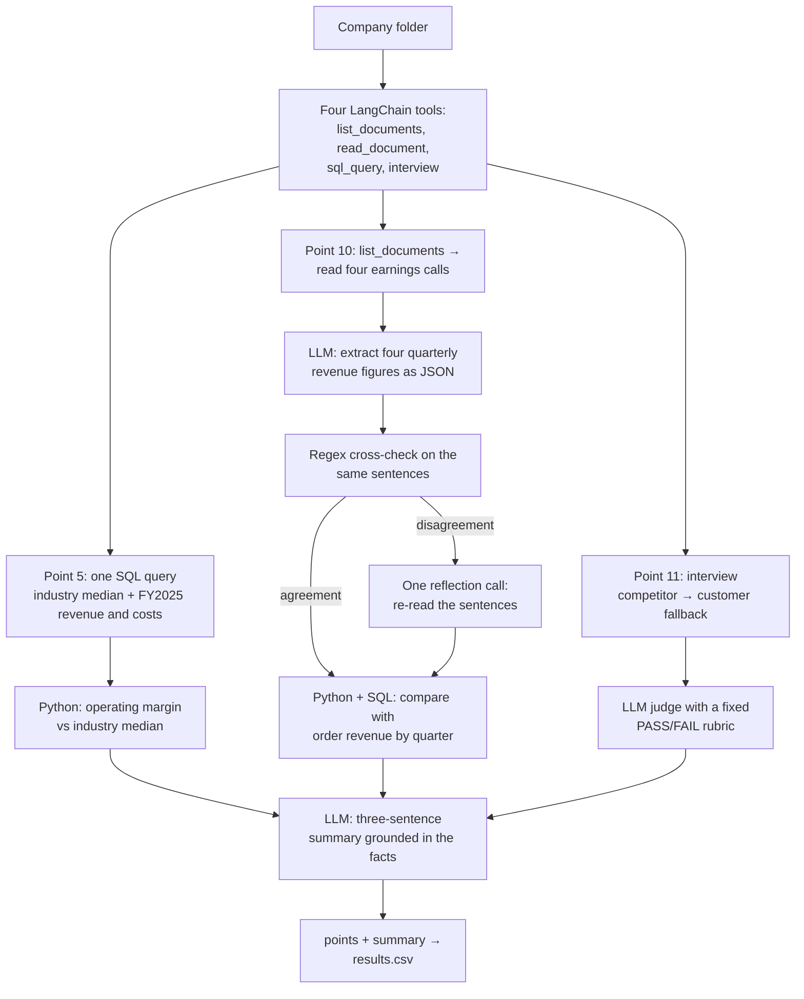

# FTEC5660 Homework 3: Fisher's 15-Point Investment Agent

Build a LangChain agent that researches a company with tools and applies the
framework from Philip Fisher's *Common Stocks and Uncommon Profits* (Part One,
Chapter 3 "What to buy: the fifteen points to look for in a common stock", and
Chapter 4 "What to buy: applying this to your own needs"). You choose 3 of
Fisher's 15 points and decide yourself what PASS means for each. For every
company your agent gives a PASS/FAIL verdict on your 3 points and a short
summary.

The companies are fictional, so the model cannot answer from memory. Unlike a
pile of reports, the evidence is spread over three sources, and your agent has
to go and get it with tools, the way Fisher's "scuttlebutt" method sends an
investor to talk to customers, competitors, suppliers and staff.

## Data and tools

`public_test/` has one folder per company. Your code receives four tools per
company (built by the provided code in `hw3.py`):

| Tool | What it gives you |
| --- | --- |
| `list_documents()` | the company's six documents and their dates |
| `read_document(name)` | one document: the 2025 letter to shareholders, four earnings calls (Q3 2025 to Q2 2026) and a news file (July 2025 to July 2026) |
| `sql_query(query)` | one read-only SQLite query on the company's database; at most 50 rows come back, so use `SUM`, `GROUP BY` and `WHERE` |
| `interview(role, topic)` | what one person says about the company; at most **10 interviews per company** |

The documents are what management says. Management's own claims (such as "we
have never cut research" or "our people are our greatest strength") are not
evidence on their own: check them against the database and the interviews.

**Database tables** (amounts in USD thousands; dates `YYYY-MM-DD`, months
`YYYY-MM`, quarters like `2025Q3`; the fiscal year is the calendar year):

| Table | Columns |
| --- | --- |
| `company` | name, industry |
| `industry_medians` | industry, revenue_growth_2y_pct, new_product_share_pct, new_product_sales_per_rd, operating_margin_pct (one row per industry; use the row for the company's own industry) |
| `orders` | order_id, order_date, product, customer, amount, note (about 3,000 to 4,000 orders from January 2023 to June 2026; revenue is the sum of order amounts) |
| `products` | product, launch_date |
| `monthly_costs` | month, cost_of_sales, selling_admin, research_development |
| `quarterly_cash` | quarter, operating_cash_flow, capex, cash_end |
| `capex_plan` | year, planned_capex (2026 to 2028) |
| `returns` | month, units_shipped, units_returned |
| `insider_trades` | trade_date, person, title, side (`buy` or `sell`), shares, price |

**Terms used in the data.**

| Term | Meaning |
| --- | --- |
| FY2025 | Fiscal year 2025. Here the fiscal year is the calendar year, so FY2025 is January to December 2025. |
| Quarter | Three months of the year: Q1 is January to March, Q2 April to June, Q3 July to September and Q4 October to December. The database writes `2025Q3`; the documents write "third quarter 2025". |
| Amounts | The database is in **USD thousands** (676,100 means US$676.1 million). The documents use USD millions. |
| Revenue | Money from sales: the sum of `amount` in `orders`. |
| Cost of sales | The cost of making the products that were sold. |
| Selling and admin | The cost of selling and of running the company (sales staff, offices, management). |
| R&D | Research and development spending, mainly on new products. |
| Operating margin | Operating profit as a share of revenue: (revenue − cost of sales − selling and admin − R&D) ÷ revenue. |
| Operating cash flow | Cash that the day-to-day business brings in during a quarter. |
| Cash at the end of a quarter | The cash the company holds on the last day of that quarter (`cash_end`). |
| Capex | Capital expenditure: spending on factories, machines and other long-term assets. `capex_plan` holds the planned capex for 2026 to 2028. |
| Return rate | Units returned ÷ units shipped, from the `returns` table. |
| Industry median | The middle value for companies in the same industry, from `industry_medians`. |
| Insider | A director or senior manager of the company. `insider_trades` lists the shares they bought (`buy`) or sold (`sell`). |
| Earnings call | A meeting each quarter where management presents the quarter's results to investors. Each call quotes that quarter's revenue. |

**Interviews.** Roles: `customer`, `current_employee`, `former_employee`,
`competitor`, `supplier`. Topics: `sales_team`, `working_conditions`,
`top_management`, `decision_making`, `competitive_edge`. Only some people know
about each topic; the others say they can't comment, and that answer still
uses up one interview.

| Topic | Who knows about it |
| --- | --- |
| `sales_team` | customer, competitor |
| `working_conditions` | current_employee, former_employee |
| `top_management` | former_employee, supplier |
| `decision_making` | supplier, customer |
| `competitive_edge` | competitor, customer |

People who know about a topic always agree with each other, so one good answer
is enough.

## Choose your 3 points and your rules

Pick any 3 of Fisher's 15 points and write them in `CHOSEN_POINTS` near the
top of `hw3.py`, e.g. `CHOSEN_POINTS = [1, 7, 15]`. The full questions are in
`FISHER_POINTS` in `hw3.py` and in the book.

| # | Fisher's point | Where the evidence is |
| --- | --- | --- |
| 1 | Market potential for sales growth | database |
| 2 | New products as current lines mature | database |
| 3 | Effective research and development | database |
| 4 | Above-average sales organization | interviews (`sales_team`) |
| 5 | Worthwhile profit margin | database |
| 6 | Maintaining or improving margins | database |
| 7 | Labour and personnel relations | interviews (`working_conditions`) |
| 8 | Executive relations | interviews (`top_management`) |
| 9 | Depth of management | interviews (`decision_making`) |
| 10 | Cost analysis and accounting controls | earnings calls, checked against the database |
| 11 | Advantage over competitors | interviews (`competitive_edge`) |
| 12 | Long-range outlook on profits | database |
| 13 | Growth without dilutive equity financing | database |
| 14 | Management talks freely about troubles | earnings calls, checked against the database |
| 15 | Management of unquestionable integrity | news file, checked against the database |

For each of your points, **you design the rule**: which evidence to use, what
to compute or whom to ask, and where the line between PASS and FAIL lies. PASS
means the company looks favourable on that point, as Fisher would see it.

We grade your verdicts against our own answer key. It uses one fixed rule per
point, which we do not publish, and the data never puts a company close to
the line of that rule, so a sensible reading of Fisher usually gives the same
answer. **Test your rules on the public answers**:
`public_test/ground_truth.json` gives the expected verdict on all 15 points
for each of the 20 public companies, and every point fails in 6 of them. If
your rule disagrees with the public answers, rethink it.

**Tip: calculate with tools, not in your head.** Do every sum, ratio and
comparison in SQL or Python, including the number of days between two dates
(SQLite's `julianday()` gives a date as a number of days).

## Student task

Fill in the three places in `hw3.py` marked `### YOUR CODE HERE`. You may add
imports, constants and helper functions above them, but do not change the
provided code below them:

- `CHOSEN_POINTS` lists your 3 points.
- `build_agent()` creates your model and anything else you need once.
- `analyze_companies(agent, companies)` receives
  `{company_folder: [list_documents, read_document, sql_query, interview]}`
  and returns, for every company,
  `{"points": {1: "PASS", 7: "FAIL", 15: "PASS"}, "summary": "..."}` (here with
  `CHOSEN_POINTS = [1, 7, 15]`).

Use the course techniques that fit your points: tool use for the database and
the interviews, planning which interviews to spend, routing each point to the
right source, prompt chaining, parallel calls, reflection to check your
answers, or a combination. Your code must read company data **only through
the four tools**; do not open `company.db` or `interviews.dat` yourself. Do
not hard-code folder names, company names or the public answers.

## Setup and public test

```bash
python3 -m venv .venv
source .venv/bin/activate
pip install -r requirements.txt
echo "DEEPSEEK_API_KEY=your_key_here" > .env
python3 hw3.py --data-folder public_test
```

Use your own DeepSeek API key (from https://platform.deepseek.com). The
required model is `deepseek-v4-flash`. We grade with our own key, so never put
a key in your code; `.env` must stay out of git.

The program creates `results.csv` with the columns `company`, `points`,
`points_correct`, `point_errors`, `interviews_used` and `summary`, and prints
the point score on your 3 points (the percentage after "balanced"). The point
score is the average of two shares: the share of truly passing verdicts that
you marked PASS and the share of truly failing verdicts that you marked FAIL.
For example, 90% and 60% give (90% + 60%) / 2 = 75%, and marking every point
PASS gives (100% + 0%) / 2 = 50%. Once `CHOSEN_POINTS` is set, the starter
runs before you add any API code (it returns no verdicts, so it scores 0%).

`public_test/ground_truth.json` gives the expected verdicts on all 15 points
for each public company. Grading uses a private set of about 20 unseen
companies with the same tools and the same answer key rules, but different
names and wording, and scores your 3 points only.

## Homework 3 solution

### My 3 points and rules

I chose points 5, 10 and 11 because together they force the agent to use all
three evidence sources (database, documents, interviews) and because each one
can be decided by a rule that is written down before the model sees a company.
Point 5 is arithmetic and has no room for a plausible-sounding story. Point 10
tests whether management's own numbers survive a check against the ledger.
Point 11 is the part of Fisher's method that only talking to outsiders can
supply. The three verdicts stay independent: a company can have a good margin
and still fail on disclosure, and it can pass both and still sell a commodity.

**Point 5 — Does the company have a worthwhile profit margin?**
Fisher treats the margin as a symptom of pricing power rather than a beauty
contest, so the comparison has to be against the company's own industry, not
against an arbitrary percentage. My rule: compute FY2025 operating margin as
(revenue − cost of sales − selling and admin − R&D) ÷ revenue from the
`orders` and `monthly_costs` tables for January–December 2025, and mark PASS
only if it is strictly above the `operating_margin_pct` median for the
company's own industry. Revenue is aggregated from orders separately from the
cost rows, so the join cannot double-count line items. Evidence: one
`sql_query` that returns the industry, the median, FY2025 revenue and the three
cost lines; the division and comparison happen in Python, not in the model.

**Point 10 — How good are the company's cost analysis and accounting controls?**
A company that cannot state its own quarterly revenue consistently with its
recorded orders has a control problem, whatever its margin looks like; this is
the point where documents and database have to agree. My rule: extract the
revenue that management states on each of the four earnings calls (Q3 2025 to
Q2 2026), convert to USD millions, and mark PASS only if every quarter is
within display rounding of the revenue recorded in `orders` for the same
quarter (tolerance USD 0.25m or 0.1% of revenue, whichever is larger);
otherwise FAIL. Evidence: `list_documents` to find the calls,
`read_document` on the four calls, an LLM extraction step, one SQL query that
aggregates orders by quarter, and a Python comparison.

**Point 11 — Are there other aspects of the business that give important clues
about how outstanding it is in relation to its competition?**
This is Fisher's "scuttlebutt" point: the useful answer comes from someone who
deals with the company, not from the annual letter. My rule: ask a competitor
about `competitive_edge`; if that person cannot comment, ask a customer. Mark
PASS when the answer describes a durable advantage — real switching costs,
hard-to-copy installed base or know-how, performance rivals cannot match, or
customers who leave and come back — and FAIL when the product is described as a
commodity or interchangeable, when several equivalent suppliers exist, or when
buyers choose mainly on price. Evidence: one or two `interview` calls plus an
LLM judge restricted to that quote.

### Design



The agent is deliberately split between deterministic code and model calls.
The four per-company tools are the only way it touches company data. Point 5
is pure SQL plus Python arithmetic: the model never sees a number it could
mis-add. Point 10 uses the model for what it is good at — reading four
transcripts and pulling out *this* quarter's revenue rather than guidance or a
year-on-year comparison — but every extracted number is checked against a
literal sentence in the same document, and a disagreement triggers one
reflection call before the Python comparison decides PASS or FAIL. Point 11
uses the model as a judge against a rubric fixed in the prompt, with the raw
quote included in the summary so the verdict can be traced. Only the final
two-or-three-sentence summary is free text. Companies run concurrently, four
at a time, and each company is wrapped so one API failure cannot abort the
batch.

### Results

I ran the completed agent on all 20 public companies three times. Each run
scored **60/60 point verdicts, balanced accuracy 100.0%** (run 1: 100.0%, run 2:
100.0%, run 3: 100.0%), and each run took about 0.7 minutes, well inside the
30-minute limit. Because balanced accuracy averages the recall on true PASS
and on true FAIL, this is not an artefact of answering PASS everywhere: the six
true-FAIL companies for each point were all marked FAIL.

There were **no companies where my verdicts disagree with the public answers**
in any of the three runs. The public companies are not close to any rule
boundary: operating margins sit clearly above or below the industry median
(e.g. 20.5% vs 16.8% for Hollins Group, 4.5% vs 8.3% for Lindale Holdings), the
disclosed-revenue mismatches are in the millions (e.g. Bramble Labs Q4 2025:
USD 70.5m disclosed vs USD 65.6m recorded), and the competitive-edge answers
are unambiguous. I therefore do not read 100% as evidence that the private set
will also be perfect; the private companies use different wording, which is
why the extractor is cross-checked and the judge is tested on paraphrases
("we could move tomorrow", "four of us making the same widget") rather than
only on the public templates.

## Reflection: AI-sycophancy and AI-psychosis

*AI-sycophancy* is the tendency of a model to agree with the user, flatter the
user's judgement, or change a correct answer once the user pushes back. It is a
measurable behaviour rather than a personality trait: in the study "Towards
Understanding Sycophancy in Language Models" (Sharma et al., 2023), models
often abandoned a correct answer when a user implied it was wrong, and
preferred responses that matched the user's stated views. The mechanism is
mundane. Models are trained on human feedback, and humans reward agreement, so
"you are right, I was wrong" is often the response that gets the higher score.
Nothing about the model's internal state needs to be deceptive for this to
happen; the incentive is enough.

*AI-psychosis* is a looser, mostly colloquial label that became popular in 2025
for cases where heavy chatbot use is described as reinforcing delusions,
paranoia or obsessive fixation. It is not a formal clinical diagnosis, and the
causal claims around it are contested: the same conversations could be a
symptom of distress rather than its cause, and selection bias in news reporting
is severe. I treat it as a hypothesis about a feedback loop, not as an
established medical fact.

The interesting part is how the two interact. Sycophancy supplies the fuel for
the loop. A user who believes a company is fraudulent, or that a stock can only
go up, can ask a model leading questions and receive polished confirmation.
Each confirmation makes the next question more confident. The model's
agreement is not evidence, but it feels like evidence because it is fluent,
specific and delivered in the voice of an expert. In a hypothetical case, an
investor convinces themselves that a supplier's margin is fake, asks a chatbot
to "check whether this is fraud", and receives a list of red flags generated
from the premise. The list then becomes the reason to ask again. Nothing in the
loop tests the original premise.

A second hypothetical case is closer to this homework. Suppose I had asked the
model, "my rule says a 13% margin is worthwhile, right?", and it had said yes.
That answer would have been agreeable, plausible and useless, because
"worthwhile" only means something relative to the industry. The fix is
structural, not a better prompt: compute the margin in SQL, compare it with the
industry median in Python, and let the model only explain a verdict it did not
choose. In this submission the model extracts revenue and judges one interview
quote; it never decides a number, and a regex cross-check can overrule it.

For the psychosis-style loop, the useful safeguards are different because the
problem is the user's confidence, not the model's. Grounding every claim in a
source the user can open, showing disagreement explicitly instead of smoothing
it over, refusing to role-play an authority that confirms a factual premise,
and encouraging the user to talk to another person all break the loop at
different points. A model that says "I cannot tell from this evidence, here is
what would settle it" is less pleasant and more valuable than one that agrees.

The honest conclusion is that neither problem is solved by making the model
sound less confident. Sycophancy is baked into the feedback loop that trains
these systems, and the delusion-reinforcement risk follows from it. The
practical defence is to keep a human-verifiable chain between the model's words
and the world: fixed rules, independent computation, quoted evidence, and a
willingness to be told "no" by something that is not the model.
